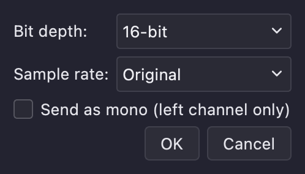

# AKAISDS Help

---

## Contents

- [MIDI Setup](#midi-setup)
- [Using a DAW at the Same Time](#using-a-daw-at-the-same-time)
- [Sending & Receiving Samples](#sending--receiving-samples)
- [Program & Keygroup Editor](#program--keygroup-editor)
- [Yamaha A4000/A5000 Editor](#yamaha-a4000a5000-editor-experimental)
- [MIDI Troubleshooting & Diagnostics](#midi-troubleshooting--diagnostics)

---

## MIDI Setup

**1. Connect your sampler**

Connect your sampler to your MIDI interface. The MIDI output of your sampler should be connected to your interface's MIDI input, and vice versa.

**2. Configure MIDI Settings**

Select your MIDI Input/Output ports and choose your sampler type: Akai S1000, Akai S2000/S3000, Akai S900/S950 (experimental), Ensoniq ASR-X (untested, experimental), Ensoniq EPS/ASR (untested, experimental), Generic SDS or Yamaha A4000/A5000 (experimental). Set the SysEx Device ID (usually 0; this is not your MIDI channel, and a wrong one gets no reply).

- The **S900/S950** uses its own protocol, needs both a MIDI input and output, and hasn't been tested on real hardware yet - back up your sampler first.
- The **Ensoniq EPS/EPS-16+/ASR-10** uses Ensoniq's own protocol (not Generic SDS), needs both a MIDI input and output, and has never been tried on real hardware - back up the unit first. Set the Device ID to its base MIDI channel minus 1 (0-15) and turn *MIDI SysEx Enable* on. Listing, receiving and sending samples work (each sent file becomes a new instrument; nothing is overwritten); there is no editor. The ASR-X has its own entry below.
- The **Ensoniq ASR-X** has no MIDI Sample Dump Standard, so Generic SDS cannot work with it; it has its own *Ensoniq ASR-X* sampler type, which needs both a MIDI input and output and has never been tried on real hardware - back up the unit first. Set the Device ID to the unit's *SysEx Device ID* (System/MIDI page, default 0) and turn *SysEx Recv* on. Listing, receiving and sending samples work (each sent file becomes a new sample, a stereo file two; nothing is overwritten); transfers run at MIDI speed, about 5 minutes for 10 seconds of audio; there is no editor.
- The **Yamaha A4000/A5000** needs a *Device Number* set on the sampler (0 is what AKAISDS expects) and *Bulk Protect* switched **off**. See [Yamaha A4000/A5000 Editor](#yamaha-a4000a5000-editor-experimental).

You can test your MIDI setup in the **Troubleshooting** tab. If you're having connectivity issues, check your MIDI connections to ensure they are not reversed. If you still don't see your sampler listed in the MIDI Hardware Test tab, see [MIDI Troubleshooting & Diagnostics](#midi-troubleshooting--diagnostics) for details.

The **Appearance** setting (Settings tab) switches between *System* (follows your computer's light/dark mode), *Light* and *Dark*. It applies straight away.

---

## Using a DAW at the Same Time

You can use AKAISDS and a DAW (Ableton Live, Logic, etc.) with the same MIDI interface, just **not at the same time**. In your DAW don't route the sampler's MIDI input into a MIDI track that outputs back to it.

Why? If another program sends your sampler's own replies back to it, the sampler treats them as commands. At best that changes or undoes a setting you just edited. At worst the sampler can be told to load, delete or save data.

If AKAISDS notices this happening, it shows a **Stray MIDI replies** warning. Close or reconfigure the other program before you carry on editing. The warning comes back if it happens again.

---

## Sending & Receiving Samples

**1. Drag audio files into the queue**

WAV, AIFF, FLAC, MP3, Ogg Vorbis and Opus are all supported (compressed files are converted to PCM when sent), as are ReCycle `.rx2` loops, which are queued as one row and sent as individual slices. Dragging in entire folders works too. AAC/M4A is not supported.

**2. Adjust quality settings (optional)**

You can set quality globally via the Transmission Settings button or individually via the Edit button next to each sample. Reducing quality will significantly reduce the transfer time (MIDI Sample Dumps are notoriously slowwwww 🐌).

**3. Hit Send!**

If you've never used MIDI sample dumps before, expect them to be slow. Very slow. Reducing bit depth or sample rate will help speed up the transfer, at the expense of sound quality.

If the sampler stops replying part way through a send (for example, its MIDI cable comes unplugged), AKAISDS re-sends the packet it's stuck on a few times. If there's still no reply, it finishes sending the current sample without confirmation, tells you the sample is unverified (check it on the sampler), and cancels any other files still waiting in the queue.

**Receiving Samples**

In the right hand list of *Currently Loaded Samples*, select which samples you would like to receive from the sampler. Then click the *Receive Samples* button, which will then ask where you want to save the samples. Transmission will commence once you have selected a location to save the received samples.

**Approximate transfer times for a 5-second sample:**

| Sample Rate | 16-bit   | 8-14 bit |
| ----------- | -------- | -------- |
| 44100 Hz    | ~3.7 min | ~2.5 min |
| 30000 Hz    | ~2.5 min | ~1.7 min |
| 22050 Hz    | ~1.9 min | ~1.2 min |
| 15000 Hz    | ~1.3 min | ~50 sec  |
| 11025 Hz    | ~56 sec  | ~37 sec  |
| 8000 Hz     | ~41 sec  | ~27 sec  |

Note that **bit depth** is a two-tier step, not a smooth scale. An 8-bit sample will take just as long as a 14-bit sample to transfer. So there is no benefit to reducing to less that 14-bit specifically for speed. Reducing **sample rate** does scale linearly. Half the sample rate means half the transfer time, but at the expense of higher frequency audio content.

These are theoretical best-case figures based on MIDI's fixed wire speed of 31,250 baud. Real world transfers may be slower, depending on how quickly your specific sampler responds to each data packet.

---

## Program & Keygroup Editor

**IMPORTANT!** The editor function is relatively new and may have unexpected bugs. It is *strongly* recommended to back up your data before use.

The editor is powered under the hood by *s3ked*. It offers control over the most commonly used functions in an Akai S2000 and S3000 series samplers. Not all functions have controls (yet). The intention was to keep the interface as easy to understand as possible at first glance.

The editor also supports the Akai S1000 (experimental) - set the Sampler Type to *Akai S1000* in Settings first. An S1000 has no Multi tab, Global tab, modulation matrix, LFO2, portamento, mute groups or velocity start, so those controls are hidden. Its Envelope 2 is a plain ADSR, and its fixed controller routing (what velocity, key, pressure and the mod wheel do) is editable in the *Controllers* cards instead of a modulation matrix.

With the Sampler Type set to *Akai S900/S950 (experimental)*, the Open Editor button opens a separate, smaller editor for the S900/S950: programs and keygroups can be edited and written back to the sampler in one go (the previous values are backed up first), and its Samples tab is read-only. With *Yamaha A4000/A5000 (experimental)* it opens the [Yamaha editor](#yamaha-a4000a5000-editor-experimental).

By default the editor opens up on the Programs page. It will take a second or two to load, especially if you have lots of Programs and Keygroups on your Akai sampler.

This is not an extensive deep dive into the editing functions of an Akai sampler, it is assumed you are already familiar with the workflow of Akai samplers.

**Keyboard shortcuts:** Command/Ctrl + 1, 2, 3 and 4 switch between the Multi, Programs, Samples and Global tabs. Command/Ctrl + T goes back to the Transfer Dashboard.

### Programs Tab

To create new Programs or Keygroups, right click on an existing Program or Keygroup, then click *Duplicate Program...* or *Duplicate Keygroup...*

To open the Keygroup settings, select a Keygroup in the list. To go back to the Program settings page, select a Program in the list.

**Saving and loading programs**

The **Save...** and **Load...** buttons under the Programs list (or right click a program) save a program to a file in Akai's own program format (`.p3` for S2000/S3000, `.p1` for S1000) and load one back in. A loaded program always arrives as a **new** program - it never overwrites one, and if its name is already used on the sampler you'll be asked for another.

Samples are **not** stored in the file. A program refers to its samples by name, so load the samples onto the sampler first (the Load dialog lists any the sampler doesn't have yet). A `.p1` file loaded onto an S2000/S3000 is converted first - AKAISDS asks you to confirm, and the sampler's own conversion of some S1000 settings isn't replicated. This feature is experimental, so back up first.

### Keygroup Page

**Mute Group** (Range card) makes keygroups cut each other off, like a closed hi-hat choking an open one. Keygroups in the same group (1-32) silence each other when one plays; **Off** lets a keygroup ring freely. Be careful with keygroups that cover the same notes: if they are all in the same group only one of them will sound. A duplicated keygroup keeps its mute group, so check it on the copy.

**Vel. start** (next to *Velocity High* on each zone) moves the sample's start point depending on how hard you play, from -9999 to +9999 sample points. 0 means the start never moves. It's handy for drum samples. Hold *Shift* while dragging for fine control, or click the knob and type a number.

*(S2000/S3000 only - an S1000 doesn't have these two controls.)*

The **envelope graphs** are editable too: drag a dot to change the stage it sits on (or the flat sustain line, up or down, for just the sustain level) (the knobs follow as you drag, and the sampler is only updated when you let go). Hold *Shift* for fine control, double-click a dot to reset it, or press *Esc* mid-drag to cancel.

### Multi Tab

The Multi tab is where you can assign Programs to various parts of a Multi. You can also rename your Multi if desired.

### Samples Tab

The Samples tab is where you can edit loop points, trim samples, rename samples, fade samples in and out, normalise samples, reverse samples and filter samples.

The list of samples will appear on the left. You can right click a sample to delete or rename it.

To load the sample's waveform, double click on the placeholder window. Loading of a sample's waveform is very slow (same speed as sending and receiving samples over SDS). It will also freeze the interface until loading is complete.

Loop points and sample start/edit markers can be edited visually without needing to load the sample's waveform. Hold down *Shift* when dragging sample markers around for more precision. Alternatively you can type a value in to the boxes below the waveform. The audio can also be previewed (including the loop points) by clicking once on the waveform. The audio preview is an approximation, not an exact 1:1 replica of an Akai sampler.

The **Root Note & Tune** section sets which key plays the sample at its original pitch and its fine tuning. **Detect Root Note** works it out for you from the loaded waveform (best with a single, clean note): it shows its confidence and you can accept or ignore the result. It adjusts the tuning on top of any compensation the sampler already applied, rather than replacing it.

Trimming, reversing, fading in and out, normalising and filtering a sample are all done by the host computer. The waveform must be loaded to the computer, and the edited sample is then sent back to the Sampler via SDS (slow) *in place* - it overwrites the sample you are editing, and there is no undo button, you have been warned. AKAISDS asks you to confirm before it sends.

Duplicating a sample also happens on the host computer and goes over SDS the same way, but it's not destructive - it sends the loaded audio to the sampler under a new name of your choosing, leaving the original completely untouched.

#### Slice Editor

Click **Slice Editor…** to chop a loaded sample, ReCycle style. Add slice markers by hand (double click the waveform, drag to move), use **Generate Equal Slices**, or drag the **Sensitivity** slider to have AKAISDS find the hits for you (it replaces all markers as you drag, so use it first). Click the waveform to preview a slice.

Every slice is exported to the sampler as a new one-shot sample, and the original is left alone. Tick the option to also create a **new program** and it will have one keygroup per slice on consecutive keys starting at C1, up to 92 slices.

### Global Tab

The Global tab holds settings of the *whole sampler* rather than one program - the ones you'd find on the sampler's own GLOBAL page. Changes are sent to the sampler as you make them. (S2000/S3000 only.)

- **Tuning & Output:** *Output level* (-18 dB to +18 dB). *Tune* and *Fine tune* are shown, but can't be changed from AKAISDS - the sampler accepts the value and then ignores it - so they're greyed out until I figure out how to get them working.
- **External Controller:** which controller the **External** modulation source follows: *Breath*, *Footpedal* or *Volume*. The same choice also appears in the Modulation card on the Programs tab, and the two always match.
- **MIDI:** the *Program change channel* (Off, 1-16 or Omni) is shown but locked, to be safe - change it on the sampler itself.
- **Play Button:** the *note*, *channel* and *velocity* the sampler's front-panel Play button plays.
- **SCSI:** *Disk ID*, *Sector size* and *Local ID* are shown but locked, to be safe - change those on the sampler itself.

Greyed-out controls explain themselves in their tooltip.

### Refreshing Sampler Data

If you edit a parameter on the front display of your sampler, the edit is unlikely to be picked up by AKAISDS automatically. To get around this, you can use the *Refresh* button on the bottom left of the window (or by pressing Command + R or Ctrl + R depending on your platform).

---

## Yamaha A4000/A5000 Editor (experimental)

This editor was built and tested on an A4000. The A5000 should work for the same things but hasn't been tried, so treat it as experimental and back up any important data first.

**Setup:** set the Sampler Type to *Yamaha A4000/A5000 (experimental)*, pick your MIDI ports (both input and output are required), and on the sampler set its *Device Number* to 0 and switch *Bulk Protect* **off** (Utility > MIDI bulk). If Bulk Protect is on, the sampler ignores every edit and cancels sample transfers - check it first if something "does nothing". Then click **Open Editor**.

**Programs tab.** The A4000 always has 128 programs, so empty ones are hidden unless you tick *Show empty programs*. Select a program to see the samples assigned to it and the settings for the program and each assigned sample. Use **Assign Sample...** and **Remove** to add or take away samples. Edits are sent to the sampler as you make them (a moment after you stop moving a control).

**Samples tab.** Shows each sample's waveform (both channels of a stereo sample as one display), its loop and start/end markers, loop mode and its parameters. Double click the waveform to load the audio (slow - it comes over MIDI). Drag the markers or turn the knobs; click the waveform to preview. **Detect Pitch** works out the sample's original key and fine tune from the audio.

**Backups.** The first time you change a program or sample in a session, AKAISDS saves a copy of it. Use **Hardware > Restore from Backup...** to put an object back as it was, and **Hardware > Open Backup Folder** to find the files.

**Edits make new samples.** The A4000 can't delete or overwrite a sample over MIDI, so **Edit Sample...** (trim, reverse, fade, normalise, filter) creates a *new* sample named like `<name> TRIM` and leaves the original untouched. The **Slice Editor** works the same way, and can also fill an **empty program** with the slices (one per key, starting at C1).

**Sending and receiving samples** use the Transfer Dashboard as usual: *Currently Loaded Samples* lists the sampler's samples, and Receive saves them as WAV files (both channels of a stereo sample). Sending needs a MIDI input as well as an output, is slow (a stereo sample takes about twice as long as a mono one), and never overwrites: if the name is taken the new sample gets a ` 2` on the end.

**If the sampler goes quiet.** After samples have been sent, the sampler can show *MIDI Bulk Received* and stop answering over MIDI until you press **OK (Knob 5)** on it - most often when you assign a freshly sent sample to a program. AKAISDS tries to warn you when this happens, and tells you when to press **OK**. It's not perfect though, so always refer to your sampler's display after making an edit.

**Not supported:** creating or deleting programs and samples (the sampler has no MIDI command for it), effects, controller and system settings.

---

## MIDI Troubleshooting & Diagnostics

There are 2 MIDI tests in the AKAISDS Settings window.

1. [MIDI Hardware Test](#midi-hardware-test)
2. [MIDI Loopback Test](#midi-loopback-test)

If things behave strangely while another music program is open (settings changing by themselves, a *Stray MIDI replies* warning), see [Using a DAW at the Same Time](#using-a-daw-at-the-same-time).

### MIDI Hardware Test

Use the Hardware test to check if your MIDI sampler is detected by your interface.

To use the hardware test, connect a MIDI cable from your MIDI interface's output to the sampler's input, and vice versa. Both input and output connections are required for this test.

Click the *Run Hardware Test* button and if successful, your sampler's details should appear in the window.

### MIDI Loopback Test

Use the Loopback Test to check if your MIDI interface can support MIDI SysEx traffic. Not all interfaces have full SysEx support.

To use the loopback test, take a MIDI cable and connect one end to the MIDI input of your interface, and the other end to the MIDI output of the same interface (ie, back into itself). Then click the *Run Loopback Test* button. The test may take up to 20 seconds depending on your hardware.

Loopback test results will be shown in a dialog box, along with your MIDI interface, operating system and AKAISDS version. Use **Copy Results** or **Share on GitHub** (opens a GitHub issue with the results already filled in) to share them so your interface can be added to the tested list.

**Reporting a problem**

Use **Help > Open Log Folder** (in the S900/S950 and Yamaha editors: **Hardware > Open Log Folder**) and send `akaisds.log` along with a description of what you were doing, which sampler you have and which MIDI interface you use. Send it straight after the problem happens, since older entries are eventually overwritten.

There is a table in the README of the GitHub repository of interfaces that have been tested using this method. If your interface isn't listed there, I encourage you to help out the community by sharing your results: click **Share on GitHub** in the results window (or submit a Pull Request).
